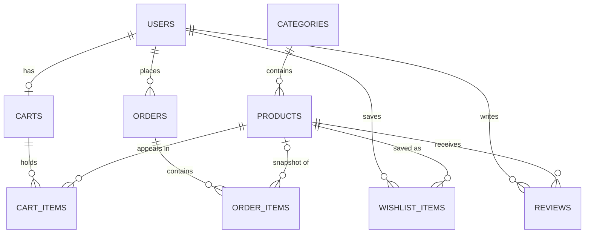

# NOVA: Modern Product Discovery & E-Commerce Platform

A full-stack e-commerce web application built with **React, Express and PostgreSQL**. Shoppers can browse and search a product catalogue, save favourites, fill a cart (as a guest or a signed-in user), check out through a five-step flow and track their orders. Admins manage products, inventory, orders and users from a dedicated dashboard.

Built as **Task 1** of the **CodeAlpha Full Stack Development Internship**, and designed to be read and learned from, not just run: the code is layered, commented where the *why* isn't obvious, and every important decision is explained below.

> **Demo store.** Payments are simulated. No real payment is taken and no card details are collected or stored.

---

## Table of contents

- [Features](#features)
- [Tech stack](#tech-stack)
- [Architecture](#architecture)
- [Database schema](#database-schema)
- [Getting started](#getting-started)
- [Environment variables](#environment-variables)
- [Demo accounts](#demo-accounts)
- [API overview](#api-overview)
- [Frontend routes](#frontend-routes)
- [Business rules](#business-rules)
- [Security](#security)
- [Project structure](#project-structure)
- [Screenshots](#screenshots)
- [Troubleshooting](#troubleshooting)
- [Deployment notes](#deployment-notes)
- [Future improvements](#future-improvements)

---

## Features

### Shopping
- **Product listing** with search, category filter, price range, in-stock filter, five sort options and pagination. Filters live in the URL, so any view can be bookmarked or shared.
- **Product details**: large image, rating, discount, stock status, quantity selector, specifications, customer reviews and related products. Handles *not found*, *out of stock*, *loading* and *API failure*.
- **Homepage** with a product-discovery hero, category explorer, trending and featured products.
- **Wishlist** saved to your account, with instant optimistic updates.

### Cart
- **Hybrid cart.** Guests keep their cart in `localStorage`; signed-in users keep it in PostgreSQL so it follows them across devices. On login the guest cart is **merged** into the saved one.
- Quantities can never exceed available stock. If stock drops after an item was added, the cart repairs itself and explains what changed.
- Subtotal, tax, shipping and total are calculated **on the server**, so guests and signed-in users always see identical numbers.

### Checkout and orders
- **Five steps:** cart review, shipping, order summary, payment, confirmation.
- Placing an order is a **single database transaction**: lock the products, re-check stock, create the order and its items, reduce inventory and empty the cart. Either everything happens or nothing does.
- Order reference such as `NOVA-2026-A8F3K2`, order history, order details with a **status timeline**, and cancellation while an order is still pending or confirmed (stock is returned automatically).

### Accounts
- Register, sign in, sign out and edit your profile.
- Passwords hashed with **bcrypt**; sessions use a **JWT in an httpOnly cookie** (never exposed to JavaScript).
- Protected pages (checkout, orders, wishlist, profile) and a separate admin area.

### Admin dashboard
- **Dashboard:** total products, users, orders and revenue, plus pending orders, a low-stock warning and recent orders.
- **Products:** create, edit and delete with **image upload**, a specifications editor and **inline inventory editing**.
- **Orders:** search, filter by status and move orders through a strict workflow (see [Business rules](#business-rules)). Cancelling restocks the items.
- **Users:** searchable, read-only list with order counts and total spend.

### Quality
- Responsive layout designed for phone, tablet and desktop, not just shrunk.
- Loading skeletons, empty states and error states with retry on every API-driven page.
- Accessibility work: visible focus, skip links, focus moved to the new page on navigation, focus trapped in dialogs, focus sent to the first invalid form field, labelled controls, and text colours checked against WCAG AA contrast.
- Admin code is **lazy-loaded**, so shoppers never download it.
- An error boundary replaces a blank page with a friendly message if the UI crashes.

---

## Tech stack

| Layer | Technology |
|---|---|
| Frontend | React, Vite, JavaScript, React Router, Axios, Bootstrap 5, custom CSS |
| Backend | Node.js, Express 5, REST API |
| Database | PostgreSQL (raw SQL with the `pg` driver, no ORM) |
| Auth | Passport (`passport-local` and `passport-jwt`), JWT in an httpOnly cookie, bcrypt |
| Uploads | Multer |
| Validation and hardening | express-validator, Helmet, CORS, express-rate-limit |
| Tooling | dotenv, nodemon, morgan |

**Why raw SQL instead of an ORM?** The project is meant to demonstrate joins, transactions, row locking and constraints directly.

---

## Architecture

```
┌────────────────────┐   Axios (JSON, cookie)    ┌──────────────────────────┐
│  React + Vite SPA  │ ────────────────────────▶ │  Express REST API        │
│  React Router      │ ◀──────────────────────── │  routes → controllers    │
│  Bootstrap + CSS   │                           │  → services → db         │
└────────────────────┘                           └────────────┬─────────────┘
        :5173                                                 │ pg (parameterised SQL)
                                                              ▼
                                                   ┌──────────────────────┐
                                                   │ PostgreSQL           │
                                                   └──────────────────────┘
                                                      :5432   + /uploads on disk
```

### Backend layering

```
routes        URL mapping, validation rules, auth middleware
   ↓
controllers   HTTP only: read the request, call a service, send the response
   ↓
services      business logic and SQL (no req/res, so it is easy to test)
   ↓
database      PostgreSQL through a shared connection pool
```

### Key design decisions

| Decision | Reasoning |
|---|---|
| **Auth in an httpOnly cookie** | JavaScript (and therefore an XSS payload) can never read the token. The frontend asks `GET /api/auth/me` on load to learn who is signed in. |
| **Checkout is one transaction with `SELECT … FOR UPDATE`** | Two people buying the last unit cannot both succeed. Rows are locked in id order so checkouts cannot deadlock. |
| **The server prices everything** | The browser sends only the address and payment choice. Items and prices come from the saved cart and the database, so a modified request cannot change what is charged. |
| **Money in integer cents** | Totals are computed with integers to avoid floating-point errors. Database columns are `NUMERIC(10,2)`. |
| **Snapshots in orders** | `order_items` stores the product name and unit price, and `orders` stores the shipping address, so later edits never rewrite history. |
| **Guest cart merge keeps the larger quantity** | Safe to repeat: a retry or double request can never double a cart. |
| **Sort and filter options are whitelisted** | Clients send a key such as `price_asc`; the server chooses the SQL, so nothing user-typed reaches `ORDER BY`. |
| **Ownership checked in SQL** | Every user-owned query includes `WHERE user_id = <id from the verified token>`. Someone else's order returns 404, not 403, so ids cannot be probed. |
| **One error shape** | Every failure returns `{ "status": "error", "message": "…", "errors": { field: message } }`, so the frontend handles errors in one place. |

---

## Database schema

Nine tables, created by `backend/src/db/schema.sql`.



| Table | Purpose |
|---|---|
| `users` | Accounts, role (`customer` or `admin`) and a default address. Email is unique **case-insensitively** through an index on `LOWER(email)`. |
| `categories` | Product categories with a unique name and slug. |
| `products` | Price, discount percent, stock, image path, `specs` (JSONB) and a featured flag. |
| `carts` / `cart_items` | One cart per user; one row per product, unique per cart. |
| `wishlist_items` | Saved products, unique per user and product. |
| `reviews` | Rating (1 to 5) and comment, one review per user per product. Average ratings are computed with `AVG()` so they cannot go stale. |
| `orders` | Reference, status, totals, payment method and a **shipping address snapshot**. |
| `order_items` | Line items with a **name and price snapshot**. `product_id` is nullable (`ON DELETE SET NULL`) so deleting a product keeps order history intact. |

**Integrity rules:** primary and foreign keys with deliberate delete behaviour (`RESTRICT` on categories and order owners, `CASCADE` on carts, `SET NULL` on order items), `NOT NULL` and `UNIQUE` constraints, and `CHECK` constraints (`price > 0`, `stock >= 0`, `discount_percent` 0 to 90, `rating` 1 to 5, `quantity > 0`, valid `role` and `status` values). Every main table has `created_at` and `updated_at`, kept accurate by a trigger. Indexes support the common queries (orders per user, products per category, reviews per product).

---

## Getting started

### Prerequisites

- **Node.js** 20.19+ or 22.12+ (required by current Vite)
- **PostgreSQL** 14 or newer, with **pgAdmin** or `psql`
- **Git**

### 1. Clone

```bash
git clone https://github.com/<your-username>/CodeAlpha_Ecommerce.git
cd CodeAlpha_Ecommerce
```

### 2. Create the database

```bash
psql -U postgres -c "CREATE DATABASE nova_db;"
```

(Or create `nova_db` in pgAdmin.)

### 3. Backend

```bash
cd backend
npm install
cp .env.example .env     # then edit .env (see Environment variables)
npm run db:migrate       # creates all tables
```

Load the demo data. Either open `backend/src/db/seed.sql` in pgAdmin's Query Tool on `nova_db` and run it, or:

```bash
psql -U postgres -d nova_db -f src/db/seed.sql
```

The seed creates 6 categories, 27 products, 4 users, 20 reviews and 7 orders. It uses the `pgcrypto` extension to create bcrypt password hashes, and it **empties the tables first**, so only run it on a development database.

Start the API:

```bash
npm run dev              # http://localhost:5000
```

### 4. Frontend

In a second terminal:

```bash
cd frontend
npm install
cp .env.example .env
npm run dev              # http://localhost:5173
```

Open **http://localhost:5173** and sign in with a [demo account](#demo-accounts).

### Scripts

| Where | Command | What it does |
|---|---|---|
| `backend` | `npm run dev` | Start the API with auto-restart (nodemon) |
| `backend` | `npm start` | Start the API normally |
| `backend` | `npm run db:migrate` | Create the tables from `schema.sql` |
| `backend` | `npm run db:reset` | **Delete everything** and recreate the tables |
| `frontend` | `npm run dev` | Start the Vite dev server |
| `frontend` | `npm run build` | Production build into `dist/` |
| `frontend` | `npm run preview` | Serve the production build locally |

---

## Environment variables

### `backend/.env`

| Variable | Required | Example | Notes |
|---|---|---|---|
| `PORT` | no | `5000` | API port |
| `NODE_ENV` | no | `development` | Stack traces are included in error responses only in development |
| `CLIENT_URL` | no | `http://localhost:5173` | The frontend's origin, used for CORS. Must match exactly. |
| `PG_USER` | no | `postgres` | |
| `PG_HOST` | no | `localhost` | |
| `PG_DATABASE` | **yes** | `nova_db` | |
| `PG_PASSWORD` | **yes** | | Your PostgreSQL password |
| `PG_PORT` | no | `5432` | |
| `JWT_SECRET` | **yes** | | Long random string (see below) |
| `JWT_EXPIRES_IN` | no | `7d` | Session lifetime |
| `BCRYPT_SALT_ROUNDS` | no | `12` | bcrypt cost factor |
| `COOKIE_NAME` | no | `nova_token` | |
| `COOKIE_SECURE` | no | `false` | Set `true` in production (HTTPS only) |
| `COOKIE_SAMESITE` | no | `lax` | `none` only for cross-site deployments |
| `MAX_UPLOAD_MB` | no | `2` | Maximum product image size |

Generate a strong `JWT_SECRET`:

```bash
node -e "console.log(require('crypto').randomBytes(48).toString('hex'))"
```

### `frontend/.env`

| Variable | Example | Notes |
|---|---|---|
| `VITE_API_URL` | `http://localhost:5000/api` | Only `VITE_`-prefixed variables reach the browser. **Never put secrets here.** |

---

## Demo accounts

Created by `seed.sql`. **For development only.**

| Role | Email | Password |
|---|---|---|
| Admin | `admin@nova.dev` | `Admin@12345` |
| Customer | `aarav@example.com` | `Password123` |
| Customer | `meera@example.com` | `Password123` |
| Customer | `rohan@example.com` | `Password123` |

---

## API overview

Base URL: `http://localhost:5000/api`. Successful responses look like `{ "status": "success", … }`; errors look like `{ "status": "error", "message": "…" }`, with an `errors` object for field validation failures (HTTP 422).

**Access levels:** 🌐 public · 🔑 signed-in user · 🛡️ admin only

### Authentication

| Method | Endpoint | Access | Description |
|---|---|---|---|
| POST | `/auth/register` | 🌐 | Create an account (rate limited). Role is always `customer`. |
| POST | `/auth/login` | 🌐 | Sign in and receive the session cookie (rate limited). |
| POST | `/auth/logout` | 🌐 | Clear the session cookie. |
| GET | `/auth/me` | 🔑 | Current user. |
| PUT | `/auth/me` | 🔑 | Update name, phone and default address. |

### Catalogue

| Method | Endpoint | Access | Description |
|---|---|---|---|
| GET | `/products` | 🌐 | List products. Query: `search`, `category` (slug), `minPrice`, `maxPrice`, `sort` (`newest`, `rating`, `price_asc`, `price_desc`, `name`), `page`, `limit`, `featured`, `inStock`. |
| GET | `/products/:id` | 🌐 | Product with specs, reviews and related products. |
| POST | `/products` | 🛡️ | Create a product (multipart form with optional `image`). |
| PUT | `/products/:id` | 🛡️ | Update a product. |
| PATCH | `/products/:id/stock` | 🛡️ | Set stock quantity. |
| DELETE | `/products/:id` | 🛡️ | Delete a product (orders keep their snapshot). |
| GET | `/categories` | 🌐 | Categories with product counts. |

### Wishlist

| Method | Endpoint | Access | Description |
|---|---|---|---|
| GET | `/wishlist` | 🔑 | Saved products. |
| POST | `/wishlist` | 🔑 | Save a product (`{ productId }`). |
| DELETE | `/wishlist/:productId` | 🔑 | Remove a saved product. |

### Cart

| Method | Endpoint | Access | Description |
|---|---|---|---|
| GET | `/cart` | 🔑 | Your cart with totals. Repairs quantities if stock changed. |
| POST | `/cart` | 🔑 | Add an item (`{ productId, quantity }`). Rejected if it would exceed stock. |
| PUT | `/cart/:itemId` | 🔑 | Set an item's quantity. |
| DELETE | `/cart/:itemId` | 🔑 | Remove an item. |
| POST | `/cart/merge` | 🔑 | Merge a guest cart after login. |
| POST | `/cart/preview` | 🌐 | Price a guest's cart. Saves nothing. |

### Orders

| Method | Endpoint | Access | Description |
|---|---|---|---|
| POST | `/orders` | 🔑 | Place an order from your saved cart (`{ shipping, paymentMethod }`). |
| GET | `/orders` | 🔑 | Your orders. |
| GET | `/orders/:id` | 🔑 | One order. Returns 404 unless it is yours (admins can view any). |
| PATCH | `/orders/:id/cancel` | 🔑 | Cancel your own pending or confirmed order. |

### Admin

| Method | Endpoint | Access | Description |
|---|---|---|---|
| GET | `/admin/stats` | 🛡️ | Totals, low-stock count and recent orders. |
| GET | `/admin/orders` | 🛡️ | All orders. Query: `status`, `search`, `page`, `limit`. |
| PATCH | `/admin/orders/:id/status` | 🛡️ | Move an order to its next allowed status. |
| GET | `/admin/users` | 🛡️ | All users with order counts. Query: `search`, `page`, `limit`. |

### Other

| Method | Endpoint | Access | Description |
|---|---|---|---|
| GET | `/health` | 🌐 | API and database status. |

**Authentication and authorisation.** `authenticate` verifies the cookie and reloads the user from the database on every request (so a deleted or demoted user loses access immediately). `authorize('admin')` then checks the role: a missing or invalid session returns **401**, and a signed-in user without permission gets **403**.

**State-changing requests** (POST, PUT, PATCH, DELETE) must include the header `X-Requested-With: NOVA`. The frontend's Axios instance adds it automatically. When testing with curl, add it yourself:

```bash
curl -c jar.txt -H "X-Requested-With: NOVA" -H "Content-Type: application/json" \
  -X POST http://localhost:5000/api/auth/login \
  -d '{"email":"admin@nova.dev","password":"Admin@12345"}'

curl -b jar.txt http://localhost:5000/api/admin/stats
```

---

## Frontend routes

| Route | Page | Access |
|---|---|---|
| `/` | Home | public |
| `/shop` | Shop with filters and pagination | public |
| `/products/:id` | Product details | public |
| `/categories` | All categories | public |
| `/cart` | Cart | public |
| `/login`, `/register` | Authentication | signed-out visitors only |
| `/checkout` | Five-step checkout | signed in |
| `/orders`, `/orders/:id` | Order history and details | signed in |
| `/wishlist` | Saved products | signed in |
| `/profile` | Profile and default address | signed in |
| `/admin` | Dashboard | admin |
| `/admin/products`, `/admin/products/new`, `/admin/products/:id/edit` | Product management | admin |
| `/admin/orders` | Order management | admin |
| `/admin/users` | User list | admin |

Route guards only control what the **interface** shows. The real protection is on the server: every protected API route checks the session and role itself.

---

## Business rules

| Rule | Value |
|---|---|
| Currency | INR (change `CURRENCY` and `LOCALE` in `frontend/src/utils/constants.js`) |
| Tax | 18%, added to the subtotal (prices are stored without tax) |
| Shipping | 99 flat, **free** when the subtotal is 5,000 or more |
| Low-stock threshold | 5 units or fewer |
| Payment methods | Card, UPI, cash on delivery (all simulated) |

Pricing rules live in `backend/src/config/constants.js` and are applied by `backend/src/services/pricing.js`.

### Order statuses

| Current status | May move to |
|---|---|
| `pending` | `confirmed`, `cancelled` |
| `confirmed` | `processing`, `cancelled` |
| `processing` | `shipped`, `cancelled` |
| `shipped` | `delivered` |
| `delivered` | final |
| `cancelled` | final |

Card and UPI orders start as `confirmed` (the simulated payment succeeds instantly); cash on delivery starts as `pending`. Skipping a step is rejected by the server. Cancelling returns the items to stock inside the same transaction. A customer can cancel their own order only while it is `pending` or `confirmed`.

---

## Security

### What is implemented

- Passwords hashed with **bcrypt** (cost factor configurable, 12 by default); password hashes are never returned by any endpoint.
- **JWT in an httpOnly, SameSite cookie**; tokens are signed with HS256 and carry only the user id and role. The role is re-read from the database on every request.
- **Timing-safe login:** a dummy hash is compared when the email does not exist, and the error message is identical for a wrong email or a wrong password.
- **CSRF defence in layers:** `SameSite` cookies, a strict CORS origin allow-list, and a required custom `X-Requested-With` header on state-changing requests.
- **Rate limiting:** 300 requests per 15 minutes per IP overall, and 20 per 15 minutes on login and registration.
- **Input validation** with express-validator on every write endpoint, plus **parameterised SQL** everywhere (no string-built queries). Sort options are whitelisted.
- **Mass-assignment protection:** controllers pick fields explicitly, so a request cannot set its own `role`.
- **Authorisation in SQL:** user-owned queries are scoped by the authenticated user's id.
- **Safe image uploads:** JPG, PNG and WebP only (SVG is rejected because it can carry scripts), file type verified from the file's first bytes, size limit, and random server-chosen filenames.
- **Security headers** through Helmet; secrets only in environment variables; raw database errors are mapped to safe messages and never sent to the client.
- Stack traces are included in error responses **only** when `NODE_ENV=development`.

### Honest limitations

This is a learning and portfolio project, **not a production-hardened system**. Known gaps:

- **No token revocation.** Logging out clears the browser's cookie, but a copied token stays valid until it expires (7 days by default). There are no refresh tokens or rotation.
- No email verification, password reset or account lockout.
- Registration reveals whether an email is already taken (a usability trade-off, mitigated only by the rate limiter).
- Rate-limit counters live in server memory: they reset on restart and are not shared between multiple instances.
- Image uploads are validated by type, signature and size but are not virus-scanned, and files are stored on the local disk.
- Payments are simulated. A real gateway would bring PCI-DSS considerations that this project deliberately avoids.
- The cart's "add" step could briefly exceed stock if two requests race. Checkout re-checks stock under a database lock, which is the real guarantee.
- No audit log, no automated dependency scanning and no formal security review.

---

## Project structure

```
CodeAlpha_Ecommerce/
├── README.md
├── .gitignore
├── backend/
│   ├── index.js                  # starts the HTTP server
│   ├── package.json
│   ├── .env.example
│   ├── public/placeholders/      # demo product images (SVG, committed)
│   ├── uploads/                  # admin-uploaded images (git-ignored)
│   └── src/
│       ├── app.js                # middleware order and route mounting
│       ├── config/               # env, passport strategies, multer, constants
│       ├── controllers/          # auth, product, category, wishlist, cart, order, admin
│       ├── db/                   # pool.js, schema.sql, migrate.js, seed.sql
│       ├── middleware/           # authenticate, authorize, csrfGuard, errorHandler,
│       │                         # notFound, rateLimiter, validate
│       ├── routes/               # one router per feature
│       ├── services/             # business logic and SQL, plus pricing.js
│       └── utils/                # AppError, authCookie, files, parseSpecs, generateOrderRef
└── frontend/
    ├── index.html
    ├── package.json
    ├── .env.example
    ├── public/                   # favicon, fallback image
    └── src/
        ├── main.jsx              # providers and global styles
        ├── App.jsx               # route table (admin area is lazy-loaded)
        ├── components/           # Navbar, Footer, ProductCard, ProductGrid, CartItem,
        │                         # OrderCard, FormField, ProtectedRoute, ConfirmDialog, ...
        ├── context/              # Auth, Cart, Wishlist and Toast providers
        ├── hooks/                # useAuth, useCart, useFetch, useDebounce, ...
        ├── layouts/              # MainLayout, AdminLayout
        ├── pages/                # public and customer pages; pages/admin/ for the dashboard
        ├── services/             # Axios instance and one file per API area
        ├── styles/               # tokens.css (design system), then component and page CSS
        └── utils/                # formatCurrency, imageUrl, validators, ...
```

### Design system

All colours, type, radii and shadows are CSS variables in `frontend/src/styles/tokens.css`, so the whole look can be changed in one file. The palette is deep navy (`#0A1328`) and vivid blue (`#1C54D0`) on cool, near-white surfaces, with Inter for body text and Space Grotesk for headings. Bootstrap 5 provides the grid and responsive utilities; the visual identity is custom CSS.

## Troubleshooting

**"Cannot reach the server" on the login page.**
Usually an old copy of a server is still running and holding a port, so the new one is on a different port. Vite moves to `5174` if `5173` is busy, and then the browser is blocked by CORS because the API only allows the origin in `CLIENT_URL`. Stop the old processes (Ctrl+C in their terminals) and restart both. In Git Bash, find a process with `netstat -ano | grep -E ":(5000|5173) "` and stop it with `taskkill //PID <pid> //F`.

**`EADDRINUSE` when starting the backend.**
Something is already using port 5000. Stop it, or change `PORT` in `backend/.env` and update `VITE_API_URL` in `frontend/.env` to match.

**Products or images are missing.**
Make sure you ran `seed.sql`, and that the backend is running. Images are served by the **backend** (`/placeholders/...` and `/uploads/...`), so `VITE_API_URL` must point at it.

**`permission denied to create extension "pgcrypto"` while seeding.**
Run the seed as a PostgreSQL superuser (for example `postgres`) or ask your database admin to enable `pgcrypto`.

**Signed out unexpectedly after resetting the database.**
Your browser still has a cookie for a user that no longer exists. Sign in again (or clear the site's cookies).

**`npm run db:migrate` says a relation already exists.**
The tables are already there. Use `npm run db:reset` for a clean start (this deletes all data).

---

## Deployment notes

1. **Frontend:** run `npm run build` in `frontend/` and serve the `dist/` folder from any static host. Set `VITE_API_URL` to your public API address *before* building.
2. **Backend:** set `NODE_ENV=production`, a strong unique `JWT_SECRET`, real database credentials, `CLIENT_URL` to your frontend's exact origin and `COOKIE_SECURE=true` (HTTPS is required for secure cookies).
3. **Cookies and domains:** the safest setup is both apps on the same site (for example `app.example.com` and `api.example.com`) with `COOKIE_SAMESITE=lax`. If they are on unrelated domains, cookies become cross-site and need `COOKIE_SAMESITE=none` with `COOKIE_SECURE=true`, which weakens one of the CSRF layers.
4. **Behind a proxy or host such as Render or Nginx:** add `app.set('trust proxy', 1)` in `backend/src/app.js` so the rate limiter sees real client IPs.
5. **Uploads:** many hosts have an ephemeral filesystem, so uploaded product images would disappear on redeploy. Use persistent storage or an object store such as S3 before relying on uploads.
6. **Database:** run `schema.sql` once on the production database. **Do not** run `seed.sql` there: it deletes data and creates well-known demo passwords.

---

## Future improvements

- Automated tests: unit tests for the pricing and order-status rules, and API integration tests.
- Customer reviews: let verified buyers post and edit reviews (the table and display already exist).
- Real payments through a gateway such as Stripe, with webhooks and refunds.
- Transactional email: order confirmation, shipping updates, email verification and password reset.
- Token revocation and refresh-token rotation; account lockout after repeated failures.
- Image storage in an object store with resizing and a CDN; multiple images per product.
- Full-text search (PostgreSQL `pg_trgm` or `tsvector`) for large catalogues.
- Admin extras: category management, role changes, exports, charts and an audit log.
- Redis-backed rate limiting and caching for multi-instance deployments.
- Dark mode, internationalisation and a coupon or discount-code system.
- CI pipeline (lint, test, build) and Docker setup for one-command local start.

---

## Acknowledgements

Built for the **CodeAlpha Full Stack Development Internship** (Task 1).

**Author:** [Suyash Jain ]

This is a portfolio project. 